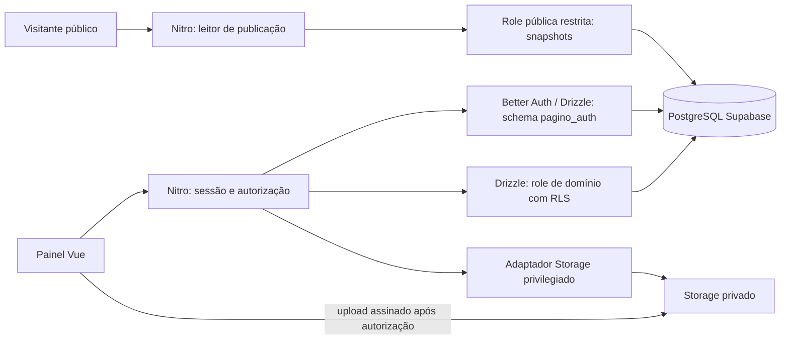

# Arquitetura proposta

Status: modelo-alvo da TASK 01, complementado por bootstrap e integração local de persistência/autenticação validados nos incrementos 02–04. A tabela inicial registra a avaliação original; evidências e limites atuais estão nas ADRs e seções finais. Integração remota continua pendente. Fontes oficiais consultadas em 11/11/2026 estão ao final. Versões do bootstrap serão fixadas na TASK 02; dependências de auth/dados na TASK 03; não copiar APIs de versões diferentes.

## Stack avaliada

| Componente | Decisão e justificativa | Validação pendente |
| --- | --- | --- |
| Nuxt + Vue 3 + TypeScript | Adotar Nuxt estável com SSR público e painel; ecossistema integrado e tipagem compartilhada | Fixar versões compatíveis e lockfile |
| Nitro | API no mesmo projeto; handlers de auth e serviços de domínio server-side | Build e runtime Vercel Node |
| PostgreSQL via Supabase | Banco relacional gerenciado com constraints e RLS | Projeto dedicado ainda não identificado |
| Drizzle ORM | Schema tipado e migrations revisáveis; acesso SQL no servidor | Adapter Better Auth, pool e roles restritas |
| Better Auth | Única fonte de identidade e sessões; adapter Drizzle PostgreSQL | Testes de cookies SSR, revogação e recuperação |
| Supabase Storage | Objetos privados e upload direto autorizado | Limites, URLs assinadas e consistência com banco |
| Vercel | Reutilizar `pagino`; Nitro em Node, não Edge | Node 26 observado; avaliar 24 LTS; plano e acesso público |
| GitHub Actions | Lint, tipos, testes e build em PR | Sem secrets de produção ou migrations automáticas |
| Vitest + Playwright | Regras unitárias e fluxos reais de navegador | Integração PostgreSQL real para RLS |

## Topologia e fluxo de confiança

Não há acesso direto do navegador à Data API ou ao PostgreSQL. Tabelas de domínio e identidade ficam nos schemas privados pagino e pagino_auth, não expostos à Data API, com grants explicitamente revogados de anon/authenticated. Se a API não for necessária, desativar exposição ao configurá-la no futuro. Realtime não é necessário.

## Autenticação e isolamento

Better Auth persiste users, accounts, sessions e verifications via adapter Drizzle. Montar handler Nitro catch-all `/api/auth/[...all]` conforme versão instalada; usar cliente Vue e encaminhamento seguro de cookies no SSR. Login e sessões no host central; cookie host-only, Secure, HttpOnly, SameSite=Lax, sem Domain abrangente. Origens confiáveis explícitas, sem wildcard de previews. Nenhuma segunda identidade no Supabase Auth. `auth.uid()` não é preenchido por uma sessão Better Auth; não basear políticas nessa suposição nem fabricar JWT Supabase no MVP.

Domínio: tabelas compartilhadas, `institution_id` obrigatório, constraints compostas, autorização por membership ativa. Fluxo para cada requisição: validar sessão no servidor → resolver instituição → verificar membership/papel → abrir transação Drizzle → configurar contexto local de user e tenant com `set_config(..., true)` → executar consultas parametrizadas e auditoria → commit/rollback. Falta de contexto nega acesso. Cada consulta e gravação continua explicitamente escopada à instituição.

Conexão `app_runtime`: não owner, sem BYPASSRLS, sem DDL; policies com USING e WITH CHECK, RLS habilitada e FORCE nas tabelas de domínio. Tenant/contexto é confiado somente ao servidor: GUC não prova identidade por si só e SQL injection comprometeria essa fronteira. RLS reduz erros de escopo, não substitui autorização. Roles de migrations separadas e nunca disponíveis ao navegador/build.

Membership: policy de leitura permite ao usuário consultar suas próprias memberships; policy do domínio valida membership ativa com o tenant do contexto. Mudanças de papel/convites são serviços restritos por permissão e constraints, sem permitir autoelevação por UPDATE genérico. Evitar policies recursivas; preferir subconsulta simples à membership sem dependência inversa. Caso função privilegiada seja necessária, exigir ADR e teste de search_path/grants antes de adotá-la.

Schema pagino_auth usa conexão/role exclusiva `auth_runtime`, com apenas DML nas tabelas Better Auth e sem acesso ao domínio. As tabelas globais não usam contexto de tenant nem RLS do domínio; ficam protegidas por schema privado, grants mínimos e API Better Auth. O adapter não deve receber a role de migration. Memberships pertencem ao Pagino: não ativar plugin de organizações com outro modelo concorrente sem revisar a decisão.

## Conexões em Vercel

Usar Supavisor em modo transaction para runtime serverless, cliente PostgreSQL compatível com Drizzle (candidato: postgres.js), prepared statements desabilitados (`prepare: false` nesse driver), pool pequeno e timeouts explícitos. Contexto deve ser transacional, nunca `SET` persistente; testar rollback e reuso concorrente. Não reutilizar objeto de transação nem tenant em globais. Migrations futuras usam conexão direta/session adequada ao ambiente administrativo, fora de builds. Região da função e banco deve ser próxima, sujeita à escolha autorizada do projeto.

## Publicação e cache

Publicação valida configuração e referências, bloqueia a linha do site e confere versão de rascunho; grava snapshot imutável e auditoria e troca `published_publication_id` na mesma transação. Idempotência evita duplicação ao repetir requisição. Site público usa role `public_reader`, sem acesso ao auth/rascunho; grants por coluna e policy só permitem site ativo e snapshot apontado. Restaurar versão cria novo rascunho e exige publicação explícita.

Começar sem cache compartilhado de HTML/dados mutáveis: `no-store` para painel, preview e leitor público. Assim, retirada de publicação não depende de invalidação. Assets públicos estáticos do app podem usar cache por hash; mídia institucional permanece privada. Cache de snapshots somente após estratégia testada com chave tenant + versão, retirada e invalidação. Não usar estado de publicação ou conteúdo pessoal em cache global sem tenant.

## Storage e consistência

Navegador solicita intenção autenticada → Nitro valida permissão, quota e reserva media com chave aleatória `{institutionId}/{mediaId}/{objectId}` → adaptador servidor cria upload assinado para chave exata sem overwrite → browser envia direto → finalização verifica bytes/MIME real/dimensões e status antes de liberar uso. Objetos rejeitados/quarentenados não são renderizados. O corpo não atravessa a Function, evitando limite de payload da Vercel. Ver detalhes em [SECURITY](SECURITY.md).

Storage usa API, nunca DML em `storage.objects`. Credencial privilegiada do adaptador ignora RLS de Storage: todas as autorizações precisam ocorrer antes da chamada. Buckets privados e ausência de permissões públicas impedem acesso genérico; URL assinada é capacidade temporária que pode ser compartilhada. Leitura pública de mídia só recebe URL curta se o objeto for referenciado pelo snapshot ativo; drafts recebem URL apenas para membro autorizado. Sem promessa de revogação instantânea de links já emitidos.

Banco e Storage não compartilham transação: lifecycle pendente → validado → disponível, tombstone para exclusão e reconciliação idempotente de órfãos. Mídia referenciada por qualquer publicação retida não pode ser apagada fisicamente. Limpeza inicial por operação administrativa explícita, sem presumir cron contratado.

## Ambientes e operação

Local/CI com PostgreSQL descartável e dados sintéticos; previews não usam produção. Integrações remotas apenas após identificação/autorização do Supabase. Configuração privada separada de runtimeConfig público. Nenhum segredo, migration ou conexão de produção em CI de PR. Deploys ligados ao Git podem ser disparados automaticamente pelo push documental; nenhum deploy é solicitado por esta tarefa e eventuais builds sem aplicação não comprovam funcionamento. Não alterar a integração apenas para ocultar esse efeito.

## Referências oficiais e limites da evidência

- [Nuxt na Vercel](https://nuxt.com/deploy/vercel): detecção Nitro e deploy via Git.
- [Better Auth / Nuxt](https://www.better-auth.com/docs/integrations/nuxt): handler Nitro e cliente Vue/SSR.
- [Better Auth / Drizzle](https://www.better-auth.com/docs/adapters/drizzle): adapter PostgreSQL e schema gerado. Nome do pacote/API depende da versão; a página consultada usa `@better-auth/drizzle-adapter`.
- [Supabase / Drizzle](https://supabase.com/docs/guides/database/drizzle): pool transacional e `prepare: false`.
- [Supabase / RLS](https://supabase.com/docs/guides/database/postgres/row-level-security): grants, policies e bypass.
- [Storage / controle de acesso](https://supabase.com/docs/guides/storage/security/access-control): buckets, policies e credenciais privilegiadas.

As fontes estabelecem compatibilidade de componentes, não comprovam a composição inteira. A TASK 03 exige experimento local de adapter + roles + RLS + pooling antes de liberar funcionalidades administrativas. URLs assinadas, limites e proteção Vercel exigem verificação remota posterior autorizada.

Schemas gerenciados do Supabase, inclusive auth e storage, não recebem tabelas/migrations do Pagino. pagino_auth é schema próprio, distinto de auth; o mapeamento do adapter para esse schema é parte da prova da TASK 03. O leitor público recebe acesso mínimo também às referências publication_media e aos metadados de media necessários, com policies que exigem referência pela publicação ativa; nunca à biblioteca inteira. O endpoint de emissão de URL pública verifica essa relação a cada pedido.

## Implementação de acesso — incremento 04

Factory em server/auth/service.ts valida configuração e roles, cria Better Auth/Drizzle e usa schemas privados. Nitro mantém somente pools/configuração em singleton; sessão e tenant são resolvidos por requisição. Middleware Nuxt protege navegação, mas APIs privadas sempre repetem autorização no servidor. A seleção lista memberships próprias e resolve cada instituição ativa com contexto transacional; dados de rascunho não passam por role pública.

Handler /api/auth/[...all] funciona como allowlist de login/logout, valida origem e JSON, aplica limite persistente atômico e remove tokens dos corpos de resposta, preservando cookie. /api/me fornece DTO sem sessão/token. Variáveis NUXT_AUTH_SECRET, NUXT_AUTH_BASE_URL, NUXT_AUTH_DATABASE_URL e NUXT_DOMAIN_DATABASE_URL são privadas e não são populadas no build com credenciais reais.
